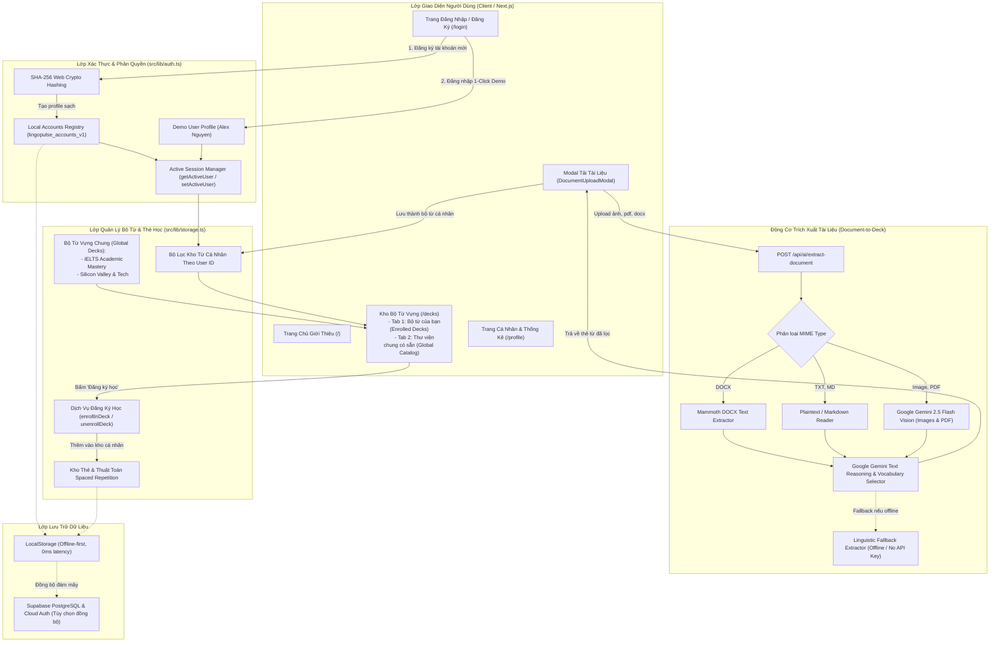
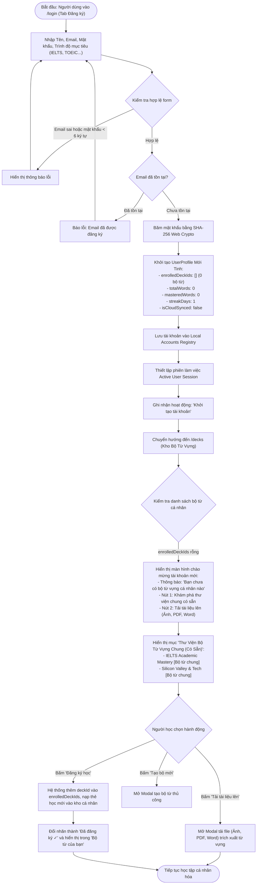
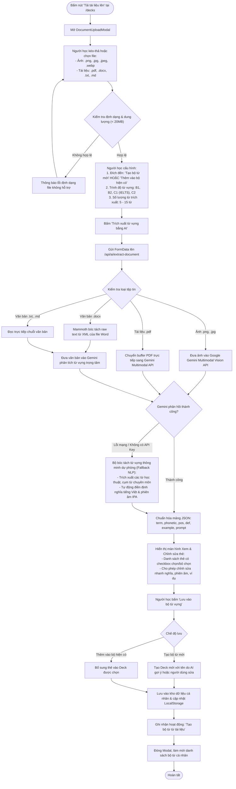

# Tài Liệu Thiết Kế: Kiến Trúc Xác Thực, Phân Tách Dữ Liệu & Tải Tài Liệu Tạo Bộ Từ Vựng

> **Tài liệu đặc tả kiến trúc phần mềm & sơ đồ luồng hệ thống**  
> **Dự án:** LingoPulse AI — Personal Language Platform  
> **Phiên bản:** 1.1.0  
> **Tác giả:** Đội ngũ phát triển sản phẩm  
> **Trạng thái:** Approved & Implemented  

---

## 1. Tổng Quan & Mục Tiêu Thiết Kế (Product & System Goals)

Kiến trúc xác thực và quản lý tài khoản của **LingoPulse AI** được thiết kế theo triết lý **Hybrid Local-First with Cloud Sync**, đảm bảo tính riêng tư, tốc độ tức thì (0ms latency), khả năng hoạt động offline hoàn toàn và phân tách dữ liệu an toàn giữa các người học:

1. **Chế độ Tài khoản Trải nghiệm (Demo / Evaluation Account):**  
   Dành cho người học muốn khám phá nhanh ứng dụng mà không cần đăng ký. Tài khoản trải nghiệm (`demo@lingopulse.ai`) được nạp sẵn 2 bộ từ vựng chuẩn kinh điển:
   - *IELTS Academic Mastery (Band 7.0 - 8.5)*
   - *Silicon Valley & Tech Communication*  
   Đi kèm các thẻ từ vựng với đầy đủ tiến độ lặp lại ngắt quãng (SRS: new, learning, mastered) và lịch sử luyện nói.

2. **Khởi tạo Tài khoản Mới Sạch Hoàn Toàn (Fresh Clean-Slate Registration):**  
   Khi người dùng mới đăng ký (`registerLocalUser`), tài khoản khởi đầu ở **trạng thái mới tinh**:
   - Kho từ vựng cá nhân trống (0 bộ từ cá nhân, 0 thẻ học, 0 thống kê ảo).
   - Thư viện **"Bộ từ vựng chung có sẵn" (Global Shared Catalog)** được hiển thị tách biệt và đánh dấu nhãn nhận diện rõ ràng.
   - Người dùng có toàn quyền chủ động chọn bộ từ phù hợp trong thư viện chung để bấm **"Đăng ký học" (Enroll)**, hoặc khởi tạo bộ từ mới.

3. **Cơ Chế Tải Tài Liệu Đa Định Dạng Tạo Bộ Từ Vựng (Document-to-Flashcards Engine):**  
   Người học có thể tải lên tài liệu học tập thực tế (Ảnh chụp giáo trình `.png, .jpg`, sách báo `.pdf`, tiểu luận/bài tập `.docx`, ghi chú `.txt, .md`). Hệ thống sử dụng Google Gemini Multimodal Vision & Text Extraction cùng bộ bóc tách chuyên dụng (Mammoth, OCR) để trích xuất tự động danh sách từ vựng trọng tâm, phiên âm IPA, định nghĩa tiếng Việt ngữ cảnh, câu ví dụ và câu hỏi luyện nói phản xạ.

---

## 2. Sơ Đồ Kiến Trúc Tổng Thể (System Architecture)



---

## 3. Sơ Đồ Luồng Đăng Ký & Khởi Tạo Trạng Thái Mới Tinh (Sign-up Flowchart)

Khi người dùng đăng ký tài khoản mới, hệ thống đảm bảo tài khoản không bị lẫn lộn dữ liệu với tài khoản trải nghiệm, đồng thời hướng dẫn người học tiếp cận kho từ vựng chung một cách tự nhiên:



---

## 4. Sơ Đồ Luồng Đăng Nhập & Chế Độ Trải Nghiệm (Sign-in & Demo Flowchart)

```mermaid
flowchart TD
    Start(["Vào trang /login (Tab Đăng nhập)"]) --> Choice{"Chọn phương thức đăng nhập"}
    
    Choice -->|Bấm 'Đăng nhập Demo (Trải nghiệm nhanh)'| LoadDemo["Kích hoạt DEMO_USER (Alex Nguyen):
    - Tự động nạp sẵn 2 bộ từ chung: IELTS Mastery & Silicon Valley
    - Đầy đủ thẻ học ở các trạng thái SRS: new, learning, mastered
    - Lịch sử hoạt động và chuỗi học tập 7 ngày"]
    LoadDemo --> SaveDemoSession["Lưu Active Session = DEMO_USER"]
    SaveDemoSession --> GoDashboard["Chuyển hướng tới /decks với đầy đủ dữ liệu mẫu"]
    
    Choice -->|Nhập Email & Mật khẩu| VerifyForm["Xác thực email và băm SHA-256 mật khẩu"]
    VerifyForm --> FindAcc{"Tìm tài khoản trong cơ sở dữ liệu"}
    FindAcc -->|Không tìm thấy hoặc sai mật khẩu| AlertAuthFail["Báo lỗi thông tin đăng nhập không chính xác"]
    AlertAuthFail --> Choice
    
    FindAcc -->|Chính xác| LoadUserProfile["Tải Profile người dùng:
    - Khôi phục danh sách bộ từ đã đăng ký (enrolledDeckIds)
    - Khôi phục các thẻ từ cá nhân và tiến độ SRS
    - Cập nhật chuỗi ngày học liên tiếp (Streak Days)"]
    LoadUserProfile --> SaveSession["Thiết lập Active Session"]
    SaveSession --> GoDashboard
```

---

## 5. Sơ Đồ Luồng Tải Tài Liệu Tạo Bộ Từ Vựng (Document-to-Flashcards Flowchart)



---

## 6. Ma Trận Dữ Liệu & Phân Tách Theo Tài Khoản (Account Isolation Matrix)

| Thuộc tính / Tài nguyên | Tài khoản Trải nghiệm (Demo) | Tài khoản Mới Đăng Ký (New User) | Tài khoản Cá Nhân Đã Học (Active User) |
| :--- | :--- | :--- | :--- |
| **Email đăng nhập** | `demo@lingopulse.ai` | Email người dùng đăng ký | Email người dùng đăng ký |
| **Bộ từ mặc định** | `deck-ielts-mastery`, `deck-silicon-valley` | Trống (`enrolledDeckIds: []`) | Các bộ đã đăng ký + bộ tự tạo |
| **Thẻ học ban đầu** | 8 thẻ mẫu (1 mastered, 4 learning, 3 new) | 0 thẻ | Số thẻ thuộc các bộ sở hữu/đăng ký |
| **Thư viện chung (Global Catalog)** | Hiển thị dạng "Đã đăng ký ✓" | Hiển thị dạng "+ Đăng ký học" | Hiển thị trạng thái tương ứng |
| **Tải tài liệu (Docx, PDF, Ảnh)** | Khả dụng (lưu vào session demo) | Khả dụng (lưu vào kho cá nhân) | Khả dụng (lưu vào kho cá nhân) |
| **Chuỗi ngày học (Streak)** | 7 ngày | 1 ngày | Tự động tăng theo ngày học thực tế |
| **Quyền chỉnh sửa bộ từ chung** | Chỉ áp dụng cục bộ | Bản sao cá nhân độc lập | Bản sao cá nhân độc lập |

---

## 7. Kết Luận & Tiêu Chuẩn Triển Khai
Kiến trúc trên đảm bảo:
- **Tính trọn vẹn của dữ liệu (Data Integrity):** Không để rò rỉ hoặc ghi đè thẻ của tài khoản trải nghiệm vào tài khoản người dùng mới.
- **Tính tự nhiên của trải nghiệm (UX Onboarding):** Người dùng mới không bị choáng ngợp bởi hàng chục thẻ từ có sẵn của người khác, nhưng dễ dàng chọn lựa các bộ từ vựng chuẩn thế giới chỉ với một cú nhấp chuột.
- **Sức mạnh AI thực chiến:** Biến mọi tài liệu học tập đời thực (sách ảnh, file PDF, Word) thành bộ thẻ Spaced Repetition cá nhân hóa trong vài giây.

