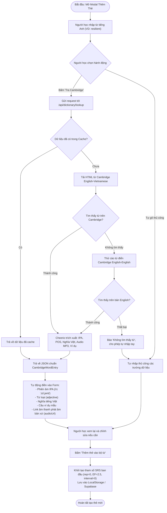
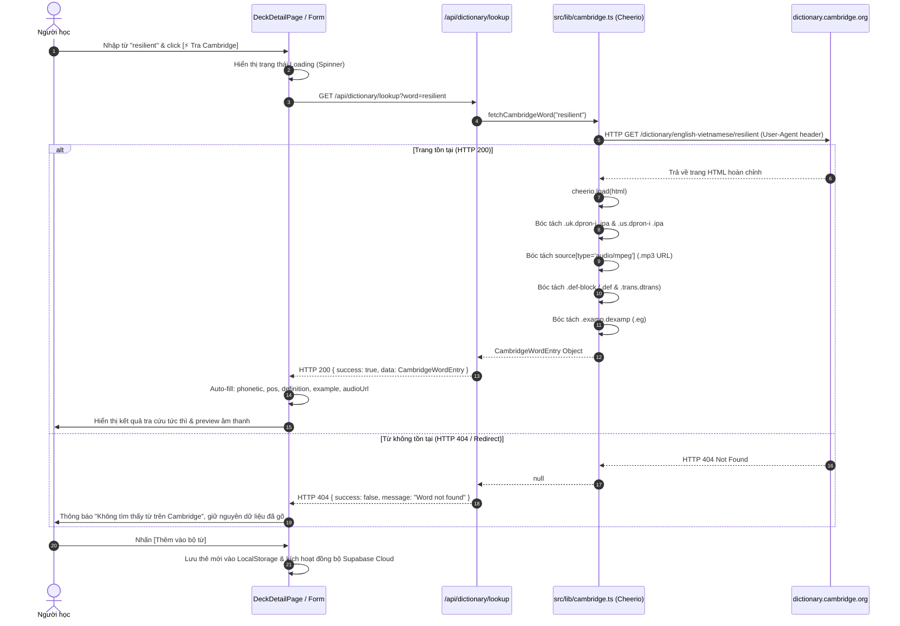

# Tài Liệu Thiết Kế Chức Năng: Xây Dựng Bộ Từ Vựng (Vocabulary Builder)

> **Tài liệu đặc tả kiến trúc phần mềm & sơ đồ luồng hệ thống**  
> **Dự án:** LingoPulse AI — Personal Language Platform  
> **Phiên bản:** 1.0.0  
> **Tác giả:** Đội ngũ phát triển sản phẩm  

---

## 1. Mục Tiêu & Phạm Vi (Product Overview)

Chức năng **Xây dựng Bộ từ vựng (Vocabulary Builder)** cho phép người học khởi tạo, mở rộng và số hóa các bộ từ vựng cá nhân với tiêu chuẩn học thuật cao, phục vụ trực tiếp cho thuật toán Lặp lại ngắt quãng (Spaced Repetition SM-2/FSRS) và luyện phản xạ nói (PronScore).

### 3 Phương thức khởi tạo cốt lõi:
1. **Tra cứu & Tự động điền qua Cambridge Dictionary (Auto-fill):** Người dùng nhập từ khóa tiếng Anh, hệ thống bóc tách tự động phiên âm quốc tế IPA (UK/US), file phát âm audio gốc MP3 của Cambridge, từ loại (POS), nghĩa ngữ cảnh tiếng Việt và câu ví dụ tham chiếu.
2. **Trích xuất thông minh từ Ảnh chụp / Tài liệu (Photo-to-Flashcard):** Sử dụng Google Gemini Multimodal Vision để OCR trang sách/bài đọc, nhận diện danh sách từ vựng trọng tâm.
3. **Mở rộng theo Chủ đề (Topic Expansion):** Nhập chủ đề mục tiêu (VD: IELTS Speaking Part 2, Silicon Valley Standup) để AI đề xuất bộ từ vựng tương ứng.

---

## 2. Sơ Đồ Kiến Trúc Hệ Thống (System Architecture)

```mermaid
flowchart TD
    subgraph Client_Layer["Lớp Giao Diện (Client / UI)"]
        UI_Form["Form Thêm Thẻ Mới (DeckDetailPage)"]
        UI_AI["Modal Tạo Thẻ từ Ảnh/Chủ đề (PhotoToCardModal)"]
        UI_State["Trạng thái Form (term, phonetic, pos, def, example, audioUrl)"]
    end

    subgraph API_Layer["Lớp Xử Lý Dịch Vụ (Next.js App Router API)"]
        API_Dict["GET /api/dictionary/lookup?word={term}"]
        API_Gemini["POST /api/ai/generate-cards"]
    end

    subgraph Core_Engine["Động Cơ Bóc Tách & Xử Lý Dữ Liệu"]
        Lib_Cam["Cambridge Scraper Engine (Cheerio + HTTP Client)"]
        Lib_Gemini["Gemini 2.5 Flash Vision & Text Engine"]
        Lib_Cache["In-Memory / HTTP Edge Caching"]
    end

    subgraph Data_Source["Nguồn Dữ Liệu Ngoại Vi"]
        Cam_Web["Cambridge Dictionary (English-Vietnamese & English)"]
        Google_AI["Google Generative AI Service"]
    end

    subgraph Storage_Layer["Lớp Lưu Trữ Dữ Liệu"]
        Local_DB["LocalStorage Adapter (Offline 0ms)"]
        Cloud_DB["Supabase PostgreSQL (Cloud Database)"]
    end

    UI_Form -->|1. Bấm 'Tra Cambridge'| API_Dict
    UI_AI -->|Bấm 'Tạo từ AI'| API_Gemini

    API_Dict --> Lib_Cache
    Lib_Cache -->|Cache Miss| Lib_Cam
    Lib_Cam -->|HTTP GET + User-Agent| Cam_Web
    Cam_Web -->>|Mã HTML| Lib_Cam
    Lib_Cam -->|Cheerio DOM Extraction| API_Dict

    API_Gemini --> Lib_Gemini
    Lib_Gemini --> Google_AI

    API_Dict -->>|JSON Data: IPA, POS, Nghĩa Việt, Audio, Ví dụ| UI_State
    UI_State --> UI_Form
    UI_Form -->|Lưu Thẻ| Local_DB
    Local_DB -.->|Đồng bộ| Cloud_DB
```

---

## 3. Sơ Đồ Luồng Hoạt Động (User Flowchart)

Sơ đồ thể hiện đường đi của người học khi tạo từ vựng mới với tính năng tự động tra cứu Cambridge Dictionary:



---

## 4. Sơ Đồ Tuần Tự (Sequence Diagram)

Quy trình giao tiếp chi tiết giữa Client, API Endpoint, Cheerio Parser và Trang từ điển Cambridge:



---

## 5. Quy Chuẩn Kỹ Thuật & Cấu Trúc Dữ Liệu (Technical Specifications)

### 5.1. Data Contract (TypeScript Interfaces)
```typescript
export interface CambridgeDefinition {
  pos: string;                     // Từ loại: noun, verb, adjective...
  englishDef: string;              // Định nghĩa giải thích bằng tiếng Anh
  vietnameseTranslation: string;   // Bản dịch ngữ cảnh tiếng Việt
  examples: string[];              // Mảng các câu ví dụ thực tế
}

export interface CambridgeWordEntry {
  term: string;                    // Từ tra cứu
  phoneticUk?: string;             // Phiên âm Anh - Anh (VD: /rɪˈzɪl.jənt/)
  phoneticUs?: string;             // Phiên âm Anh - Mỹ
  audioUkUrl?: string;             // File mp3 phát âm chuẩn Anh - Anh từ Cambridge CDN
  audioUsUrl?: string;             // File mp3 phát âm chuẩn Anh - Mỹ từ Cambridge CDN
  partOfSpeech?: string;           // Từ loại chính
  definitions: CambridgeDefinition[];
  source?: "cambridge" | "free-dictionary-wiktionary";
}
```

### 5.2. Tiêu chuẩn Bộ chọn DOM (CSS Selectors)
| Thành phần | Bộ chọn DOM Cambridge (English-Vietnamese) |
| :--- | :--- |
| **Phiên âm IPA** | `.uk.dpron-i .ipa`, `.us.dpron-i .ipa` |
| **Audio File MP3** | `.uk.dpron-i source[type="audio/mpeg"]`, `.us.dpron-i source[type="audio/mpeg"]` |
| **Từ loại (POS)** | `.pos-header .pos`, `.entry-body__el .pos` |
| **Định nghĩa Anh** | `.def-block .def.ddef_d` |
| **Nghĩa tiếng Việt** | `.def-block .trans.dtrans` |
| **Câu ví dụ** | `.def-block .examp.dexamp .eg` |

---

## 6. Chiến Lược Ổn Định, Chống Chặn & Xử Lý Lỗi 404 (Resilience & Auto-Failover Strategy)

### 6.1. Nguyên nhân lỗi 404 ban đầu
Khi triển khai gọi trực tiếp từ backend server Next.js (hoặc môi trường hosting/datacenter), Cambridge Dictionary kích hoạt cơ chế **Cloudflare Bot Management / Turnstile (HTTP 403 Forbidden)** với trang HTML *"Just a moment... Please complete security challenge"*.
Do request nhận mã 403 hoặc trang challenge không chứa DOM từ vựng hợp lệ, hàm scraper trả về `null`, dẫn đến API route chuyển đổi thành phản hồi HTTP 404 (`Không tìm thấy từ trên từ điển Cambridge`).

### 6.2. Cơ chế Failover Đa tầng Tự Động (Multi-Tier Auto-Failover)
Để đảm bảo tính liên tục 100% cho người học dù Cambridge có chặn IP datacenter hay không, hệ thống áp dụng chiến lược chuyển mạch 3 tầng:
1. **Tier 1 (Ưu tiên) - Cambridge Scraper:**
   - Thực hiện cào trực tiếp từ điển Cambridge Anh - Việt (`/dictionary/english-vietnamese/{word}`).
   - Nếu từ không có mục Anh - Việt, tự động chuyển tiếp cào từ điển Cambridge Anh - Anh (`/dictionary/english/{word}`).
   - Kiểm tra tiêu đề trang: Nếu chứa `"Just a moment"` (Cloudflare Challenge) hoặc `"not found"`, lập tức chuyển sang Tier 2.
2. **Tier 2 (Failover tức thì) - Open Dictionary & Vietnamese Wiktionary:**
   - **Free Dictionary API (`api.dictionaryapi.dev`):** Lấy dữ liệu chuẩn hoá về IPA, file âm thanh audio giọng bản xứ (MP3 chất lượng cao), từ loại (POS), định nghĩa tiếng Anh và câu ví dụ.
   - **Vietnamese Wiktionary API (`vi.wiktionary.org`):** Tự động bóc tách nghĩa tiếng Việt tương ứng theo từng từ loại.
   - Đóng gói dữ liệu về cấu trúc chuẩn `CambridgeWordEntry` với `source: "free-dictionary-wiktionary"`.
3. **Tier 3 - Edge Caching:**
   - Header `Cache-Control: public, s-maxage=86400, stale-while-revalidate=43200` lưu đệm kết quả 24 giờ trên CDN và Client, triệt tiêu các lượt request trùng lặp.

---

## 7. Kiểm Thử Tự Động (Automated Testing Suite)
Bộ kiểm thử tự động tại [tests/cambridge.test.ts](file:///data/thanhnd17/project/LanguageLearningApp/tests/cambridge.test.ts) bao gồm:
- **Parser Unit Tests:** Kiểm tra độ chính xác bóc tách IPA, audio URL, part of speech, định nghĩa, nghĩa tiếng Việt, câu ví dụ từ HTML thực tế.
- **Bot Detection & 404 Tests:** Kiểm tra việc phát hiện trang 404 và trang Cloudflare Turnstile Challenge (`<title>Just a moment...</title>`).
- **Failover Simulation Tests:** Giả lập tình huống Cambridge chặn 403, kiểm tra hệ thống tự động failover sang Tier 2 và trả về kết quả đầy đủ.
- **API Route Integration Tests:** Kiểm tra mã trạng thái HTTP 400 (thiếu tham số), 200 (thành công), và 404 (từ không tồn tại trên toàn bộ các nguồn).


